# PR0202: Uso del cliente HDFS

## Preparación del entorno
```
hdfs dfs -mkdir /andres
```

Salida:

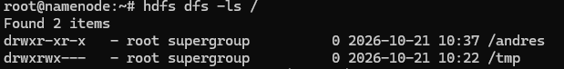

```
 hdfs dfs -mkdir /andres/proyecto_datos
```

Salida:

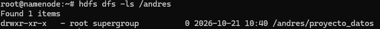

## Carga de Datasets
Primero subimos el archivo al contenedor de docker:
```
docker cp "C:\Users\abdam\Documents\fp\IA y Big Data\Big Data Aplicado\archive\vehicle_price_prediction.csv" namenode:/home/
```
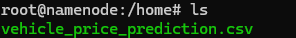


Una vez lo tenemos en docker, lo subimos a la carpeta que hemos creado en el espacio de hdfs:
```
hdfs dfs -put /home/vehicle_price_prediction.csv /andres/proyecto_datos
```
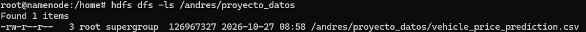

## Exploración de Datos
Visualizamos el contenido del archivo:
```
hdfs dfs -cat /andres/proyecto_datos/vehicle_price_prediction.csv
```
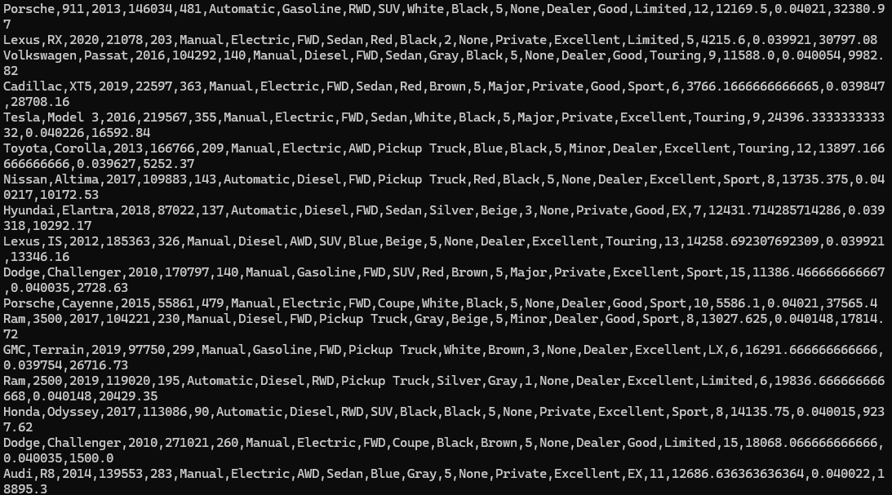

Obtenemos el número de líneas del dataset:
```
hdfs dfs -cat /andres/proyecto_datos/vehicle_price_prediction.csv | wc -l
```
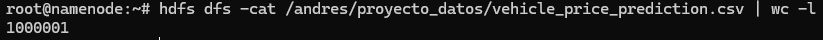

## Organización del proyecto
Creamos un subdirectorio *procesados* y otro *backup*:
```
hdfs dfs -mkdir /andres/proyecto_datos/procesados
hdfs dfs -mkdir /andres/proyecto_datos/backup
```
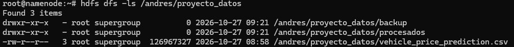

Copiamos el archivo original en *backup*:
```
hdfs dfs -cp /andres/proyecto_datos/vehicle_price_prediction.csv /andres/proyecto_datos/backup
```
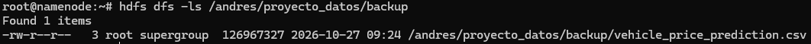

Movemos el archivo original a *procesados*:
```
hdfs dfs -mv /andres/proyecto_datos/vehicle_price_prediction.csv /andres/proyecto_datos/procesados
```
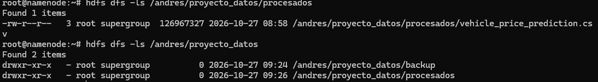


## Colaboración en el equipo
Creamos el directorio compartido:
```
hdfs dfs -mkdir /compartido
hdfs dfs -chmod 777 /compartido
```
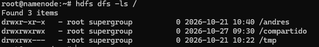

Copiamos alli el archivo:
```
hdfs dfs -cp /andres/proyecto_datos/procesados/vehicle_price_prediction.csv /compartido
```
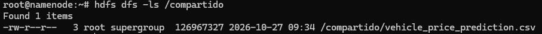

## Recuperación de datos
Descargamos en local el archivo de *procesados*:
```
hdfs dfs -get /andres/proyecto_datos/procesados/vehicle_price_prediction.csv /
```
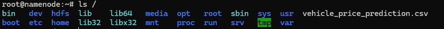

## Control de accesos
Podemos verificar los permisos de los archivos al hacer ```hdfs dfs -ls```.

Cambiamos los permisos del archivo en *backup*:
```
hdfs dfs -chmod 700 /andres/proyecto_datos/backup/vehicle_price_prediction.csv
```
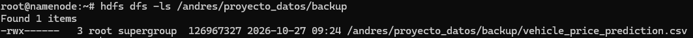

## Mantenimiento
Eliminamos un archivo temporal:
```
hdfs dfs -rm /temporal.txt
```
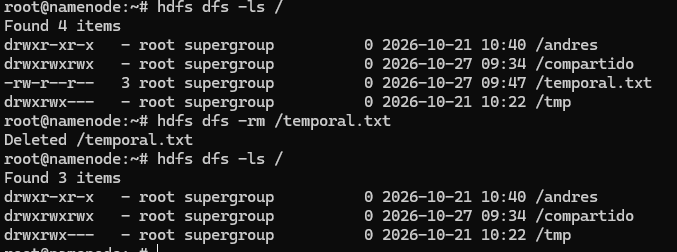


[Volver](../index.md)