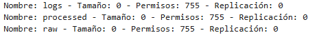
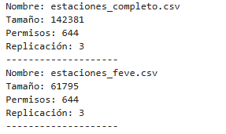
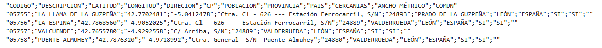
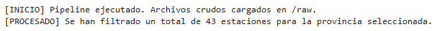
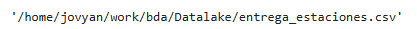
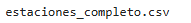

# PR0204: Pipeline de ingesta y procesamiento en Data Lake con HDFS

## Contexto
El equipo de Analítica Avanzada de movilidad necesita estudiar la infraestructura ferroviaria de España y el flujo de viajeros utilizando los datos abiertos publicados por **Renfe** en su portal oficial (https://data.renfe.com/).

Como Ingeniero/a de Datos del proyecto, tu objetivo es desarrollar un script en Python (utilizando la librería hdfs) que automatice la gestión del **Data Lake corporativo en HDFS**. Tu programa deberá encargarse de crear la arquitectura de directorios, ingestar los conjuntos de datos crudos (Raw Data), procesarlos mediante flujos de datos (streaming) para no comprometer la memoria RAM del servidor de ingesta, extraer subconjuntos de datos provinciales y mantener un registro de auditoría (logs) de las operaciones realizadas.

## Requerimientos técnicos del Pipeline en Python
Desarrolla un cuaderno de Jupyter que ejecute de forma secuencial las siguientes fases sobre el sistema de ficheros distribuido:

### Fase 1: Conexión y arquitectura del Data Lake
En los entornos profesionales de Big Data, los datos no se vuelcan en la raíz del sistema de ficheros, sino que se estructuran en capas.

1. Establece la conexión con el clúster HDFS .
    ```
    from hdfs import InsecureClient

    client = InsecureClient('http://namenode:9870', user='root')
    client
    ```
2. Crea de forma recursiva la siguiente estructura de directorios para nuestro proyecto, asegurándote de aplicar permisos POSIX ```'755'```:

    - ```/datalake/renfe/raw/estaciones```: Zona para los datos crudos de estaciones
    - ```/datalake/renfe/raw/viajeros```: Zona para los datos crudos de afluencia
    - ```/datalake/renfe/processed```: Zona para los datos limpios y filtrados
    - ```/datalake/renfe/logs```: Zona para el registro de auditoría del sistema
    ```
    rutas_datalake = {
        '/datalake/renfe/raw/estaciones',
        '/datalake/renfe/raw/viajeros',
        '/datalake/renfe/processed',
        '/datalake/renfe/logs'
    }

    for ruta in rutas_datalake:
        client.makedirs(ruta, permission='755')
    ```

3. Verifica que las carpetas dentro de ```/datalake/renfe``` se han generado correctamente.

    

### Fase 2: Ingesta concurrente de datos crudos (Zona Raw)
1. Sube los archivos ```estaciones_completo.csv``` y ```estaciones_feve.csv``` al directorio ```/datalake/renfe/raw/estaciones```.

2. Sube el archivo ```viajeros_tramo.csv``` al directorio ```/datalake/renfe/raw/viajeros```.

3. Todas las subidas deben configurarse para sobrescribir ficheros previos en caso de reejecución del pipeline (```overwrite=True```) y deben emplear **4 hilos concurrentes**(```n_threads=4```) para optimizar la transferencia.

    ```
    archivos_estaciones = ["estaciones_completo.csv", "estaciones_feve.csv"]

    for archivo in archivos_estaciones:
        client.upload(
            hdfs_path='/datalake/renfe/raw/estaciones',
            local_path='data/'+archivo,
            overwrite=True,
            n_threads=4
        )

    client.upload(
        hdfs_path='/datalake/renfe/raw/viajeros',
        local_path='data/viajeros_tramo.csv',
        overwrite=True,
        n_threads=4
    )
    ```

4. Realiza una auditoría de los archivos recién subidos en ```/datalake/renfe/raw/estaciones``` obteniendo también los metadatos de los archivos. Recorre el resultado con Python e imprime por pantalla únicamente el **nombre de cada archivo**, su **tamaño en bytes** (```length```), sus **permisos** (```permission```) y su f**actor de replicación** (```replication```).
    ```
    archivos = client.list('/datalake/renfe/raw/estaciones', status=True)

    for nombre, datos in archivos:
        print("Nombre:", nombre)
        print("Tamaño:", datos['length'])
        print("Permisos:", datos['permission'])
        print("Replicación:", datos['replication'])
        print("--------------------")
    ```
    


### Fase 3: Procesamiento en Streaming y filtrado (Zona Processed)
El archivo ```estaciones_completo.csv``` contiene todas las estaciones de la red, pero el departamento de negocio necesita un fichero específico que contenga únicamente las estaciones pertenecientes a una provincia concreta (por ejemplo, ```LEÓN```, ```MADRID``` o ```ASTURIAS```). Dado que en un entorno de producción estos ficheros pueden ocupar decenas de Gigabytes, **está prohibido cargar el fichero completo en memoria RAM** (no se permite usar Pandas ni ```.readlines()``` sobre todo el archivo).

1. Abre un flujo de lectura en streaming sobre ```/datalake/renfe/raw/estaciones/estaciones_completo.csv``` utilizando el método ```.read()``` (recuerda especificar la codificación adecuada, como ```'utf-8'``` o ```'latin-1'``` según venga el CSV de Renfe).

2. Procesa el archivo línea a línea. Conserva la primera línea (cabeceras del CSV) y filtra todas aquellas líneas que correspondan a la provincia elegida.

3. Utilizando el método ```.write()``` (con ```overwrite=True```), guarda el resultado filtrado directamente en HDFS en la ruta ```/datalake/renfe/processed/estaciones_filtradas.csv```.

    ```
    provincia = 'LEÓN'

    ruta_origen = '/datalake/renfe/raw/estaciones/estaciones_completo.csv'
    ruta_destino = '/datalake/renfe/processed/estaciones_filtradas.csv'

    contador_estaciones = 0

    with client.read(ruta_origen, encoding='latin-1') as reader:
        with client.write(ruta_destino, overwrite=True, encoding='latin-1') as writer:

            cabecera = next(reader)
            writer.write(cabecera)

            for linea in reader:
                columnas = linea.strip().split(';')

                if columnas[7].strip('"') == provincia:
                    writer.write(linea)
                    contador_estaciones += 1
    ```

4. Lee en streaming las primeras 5 líneas del nuevo archivo ```/datalake/renfe/processed/estaciones_filtradas.csv``` e imprímelas por pantalla (usando .strip()) para comprobar que el proceso de transformación ha funcionado.

    ```
    ruta_destino = '/datalake/renfe/processed/estaciones_filtradas.csv'

    with client.read(ruta_destino, encoding='latin-1') as reader:
        for i in range(5):
            linea = next(reader, None)

            if linea is None:
                break

            print(linea.strip())
    ```

    


### Fase 4: Registro de auditoría (Logging con append)

Todo proceso ETL o de ingeniería de datos debe dejar rastro de sus operaciones en un fichero de registro sin borrar los eventos anteriores.

1. Crea un archivo de registro en ```/datalake/renfe/logs/ingesta.log``` utilizando el método ```.write()``` con ```overwrite=True```, escribiendo una primera línea con el formato: ```[INICIO] Pipeline ejecutado. Archivos crudos cargados en /raw.```

    ```
    client.write(
        '/datalake/renfe/logs/ingesta.log',
        data='[INICIO] Pipeline ejecutado. Archivos crudos cargados en /raw.\n',
        overwrite=True,
        encoding='utf-8'
    )

    ```

2. A continuación, simula el registro de un segundo evento tras finalizar el filtrado de la Fase 3. Utiliza de nuevo el método ```.write()``` sobre el mismo archivo ```/datalake/renfe/logs/ingesta.log```, pero esta vez configurando el parámetro ```append=True``` para añadir al final del fichero la línea: ```[PROCESADO] Se han filtrado un total de X estaciones para la provincia seleccionada.``` (sustituyendo X por el número real de estaciones que tu código haya contabilizado en la Fase 3).

    ```
    client.write(
        '/datalake/renfe/logs/ingesta.log',
        data=f'[PROCESADO] Se han filtrado un total de {contador_estaciones} estaciones para la provincia seleccionada.\n',
        append=True,
        encoding='utf-8'
    )
    ```

3. Muestra por pantalla el contenido completo de ```ingesta.log``` leyéndolo mediante ```.read()```.

    ```
    with client.read(
        '/datalake/renfe/logs/ingesta.log',
        encoding='utf-8'
    ) as reader:
        print(reader.read())
    ```
    


### Fase 5: Exportación para el equipo de analítica y limpieza (Data Lifecycle)

1. El equipo de ciencia de datos solicita una copia local del fichero ya limpio y procesado. Utiliza el método ```.download()``` para descargar ```/datalake/renfe/processed/estaciones_filtradas.csv``` a tu máquina local con el nombre ```entrega_estaciones.csv``` (habilitando ```overwrite=True```).

    ```
    client.download(
        '/datalake/renfe/processed/estaciones_filtradas.csv',
        'entrega_estaciones.csv',
        overwrite=True
    )
    ```
    

2. Por políticas de ahorro de almacenamiento en el clúster, una vez procesados los datos o finalizadas las pruebas, debemos aplicar políticas de retención:

    - Elimina únicamente el archivo ```/datalake/renfe/raw/estaciones/estaciones_feve.csv``` utilizando el método ```.delete()``` y muestra el listado de esa carpeta para confirmar que ```estaciones_completo.csv``` permanece intacto.

        ```
        client.delete(
            '/datalake/renfe/raw/estaciones/estaciones_feve.csv'
        )
        ```
        

        ```
        archivos = client.list('/datalake/renfe/raw/estaciones')

        for archivo in archivos:
            print(archivo)
        ```
        

    - Crea una función en tu código llamada ```reset_datalake()``` que permita eliminar toda la estructura``` /datalake/renfe``` de forma recursiva (```recursive=True```) en caso de querer reiniciar el entorno desde cero (déjala definida y comentada al final del cuaderno, o ejecútala tras mostrar todos los resultados anteriores).

        ```
        def reset_datalake():
            client.delete('/datalake/renfe', recursive=True)
        ```

[Volver](../index.md)